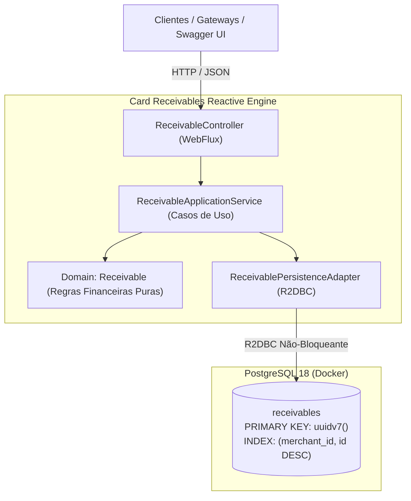
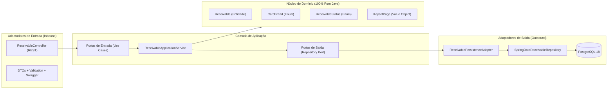

# Card Receivables Reactive Engine 🚀

> **Motor Reativo de Alta Vazão para Gestão e Liquidação de Recebíveis de Cartão**  
> Desenvolvido em **Java 25 LTS**, **Spring Boot 4.1.2**, **Spring Framework 7**, **Spring WebFlux**, **PostgreSQL 18** com **UUIDv7 Nativo (RFC 9562)** e **Keyset Seek Pagination**.

[](https://openjdk.org/)
[](https://spring.io/projects/spring-boot)
[](https://spring.io/projects/spring-framework)
[](https://projectreactor.io/)
[-336791.svg)](https://www.postgresql.org/)
[]()
[](http://localhost:8080/swagger-ui.html)

---

## 1. Visão Geral e Objetivo do Projeto

O **Card Receivables Reactive Engine** é um microsserviço financeiro voltado para adquirentes, subadquirentes, gateways e fintechs de meios de pagamento. Seu objetivo central é processar grandes volumes de transações de cartão de crédito e débito de forma totalmente reativa, assíncrona e não-bloqueante, garantindo:

1. **Alta Vazão e Baixa Latência:** Processamento de milhares de transações por segundo através da stack reativa (Spring WebFlux + Netty + R2DBC Pool + Java 25 Virtual Threads).
2. **Cálculo Financeiro Preciso:** Aplicação de taxas MDR (*Merchant Discount Rate*), divisão de parcelas, retenção de taxa e agendamento de liquidação futura (*settlement date*).
3. **Escalabilidade Extrema em Banco de Dados:** Eliminação dos gargalos clássicos de escrita e paginação em tabelas com milhões ou bilhões de registros através do **UUIDv7 nativo do PostgreSQL 18** e **Keyset Seek Pagination**.



---

## 2. Diferenciais Tecnológicos & Inovações

### 2.1. PostgreSQL 18 com UUIDv7 Nativo (RFC 9562)
Identificadores primários gerados nativamente pelo banco via função `uuidv7()`:
- **Estrutura Híbrida Tempo-Espaço:** Os primeiros 48 bits codificam um timestamp Unix em milissegundos com ordenação estrita, complementados por 74 bits de entropia aleatória.
- **Fim da Fragmentação B-Tree:** Ao contrário do UUIDv4 (aleatório), que provoca *page splits* constantes e fragmenta índices B-Tree em bases volumosas, o UUIDv7 é **monotonicamente crescente**. Ele é inserido sempre na extremidade direita do índice, comportando-se com a mesma eficiência de I/O de um `BIGSERIAL`/`IDENTITY`, mas com as vantagens de um UUID universal de 128 bits.

```
 0                   1                   2                   3
 0 1 2 3 4 5 6 7 8 9 0 1 2 3 4 5 6 7 8 9 0 1 2 3 4 5 6 7 8 9 0 1
+-+-+-+-+-+-+-+-+-+-+-+-+-+-+-+-+-+-+-+-+-+-+-+-+-+-+-+-+-+-+-+-+
|                           unix_ts_ms                          |
+-+-+-+-+-+-+-+-+-+-+-+-+-+-+-+-+-+-+-+-+-+-+-+-+-+-+-+-+-+-+-+-+
|          unix_ts_ms           |  ver  |       rand_a          |
+-+-+-+-+-+-+-+-+-+-+-+-+-+-+-+-+-+-+-+-+-+-+-+-+-+-+-+-+-+-+-+-+
|var|                        rand_b                             |
+-+-+-+-+-+-+-+-+-+-+-+-+-+-+-+-+-+-+-+-+-+-+-+-+-+-+-+-+-+-+-+-+
|                            rand_b                             |
+-+-+-+-+-+-+-+-+-+-+-+-+-+-+-+-+-+-+-+-+-+-+-+-+-+-+-+-+-+-+-+-+
```

### 2.2. Keyset Seek Pagination (Sem `OFFSET`)
A paginação tradicional com `OFFSET` degrada exponencialmente ($O(N)$), forçando o banco a percorrer e descartar milhares de linhas anteriores antes de retornar o resultado:

$$\text{Tempo com OFFSET} \propto N \quad \text{(Degradação severa em páginas profundas)}$$

A estratégia **Keyset Seek** utiliza o próprio cursor temporal composto `(merchant_id, id DESC)`:

$$\text{Query de Seek:} \quad \texttt{WHERE merchant\_id = :merchantId AND id < :cursor ORDER BY id DESC LIMIT :limit}$$

- **Complexidade Constante $O(1)$:** O banco realiza um seek direto na árvore do índice `idx_receivables_merchant_id_desc`. A consulta para a primeira página ou para a página 500.000 possui **exatamente o mesmo tempo de resposta (poucos milissegundos)**.
- **Resiliência a Leituras Sujas:** Não ocorrem saltos ou duplicações de registros quando novos dados chegam enquanto o usuário está navegando.

---

## 3. Arquitetura Hexagonal (Ports & Adapters)

O código é estritamente desacoplado, garantindo que as regras de negócio financeiras permaneçam imunes a mudanças de frameworks ou provedores de banco de dados:



- **`domain` (Puro Java):** Invariantes financeiras, cálculo de `feeAmount`, `netAmount` e determinação de `settlementDate`. **Zero dependência de Spring, JPA, Lombok ou bibliotecas externas.**
- **`application`:** Casos de uso (`CreateReceivableUseCase`, `GetReceivablesKeysetUseCase`, `GetReceivableByIdUseCase`) e definição da porta `ReceivableRepositoryPort`.
- **`adapters.inbound.web`:** Endpoints reativos Spring WebFlux, validação via Jakarta Bean Validation e anotações OpenAPI 3.0.
- **`adapters.outbound.persistence`:** Mapeamento reativo com `Persistable<UUID>`, queries segregadas de seek e integração com R2DBC.
- **`infrastructure.config`:** Configurações de pool R2DBC, Flyway com bypass para PostgreSQL 18 e beans OpenAPI.

---

## 4. Estrutura do Projeto

```text
mydbtest/
├── build.gradle                               # Configuração de dependências (WebFlux, R2DBC, Flyway, SpringDoc)
├── settings.gradle                            # Nome do projeto: card-receivables-engine
├── src/
│   ├── main/
│   │   ├── java/com/cardreceivables/engine/
│   │   │   ├── CardReceivablesApplication.java # Ponto de entrada com banner informativo e virtual threads
│   │   │   ├── domain/                        # NÚCLEO DO DOMÍNIO PURO
│   │   │   │   └── model/                     # Receivable, CardBrand, ReceivableStatus, KeysetPage
│   │   │   ├── application/                   # CASOS DE USO E PORTAS
│   │   │   │   ├── port/in/                   # CreateReceivableUseCase, GetReceivablesKeysetUseCase, etc.
│   │   │   │   ├── port/out/                  # ReceivableRepositoryPort
│   │   │   │   └── service/                   # ReceivableApplicationService
│   │   │   ├── adapters/                      # ADAPTADORES HEXAGONAIS
│   │   │   │   ├── inbound/web/               # ReceivableController, DTOs, Mappers, GlobalExceptionHandler
│   │   │   │   └── outbound/persistence/      # ReceivablePersistenceAdapter, ReceivableEntity, SpringData Repo
│   │   │   └── infrastructure/                # INFRAESTRUTURA
│   │   │       └── config/                    # OpenApiConfig, BeanConfiguration, R2DBC Config
│   │   └── resources/
│   │       ├── application.properties         # Configurações do serviço, R2DBC, Flyway e Swagger
│   │       ├── banner.txt                     # Banner ASCII personalizado no startup
│   │       └── db/migration/
│   │           └── V1__create_receivables_table.sql # DDL com uuidv7() e índice de seek
│   └── test/                                  # SUÍTE COMPLETA DE TESTES AUTOMATIZADOS (100% Green)
│       └── java/com/cardreceivables/engine/
│           ├── domain/model/                  # Testes de regras de negócio financeiras
│           ├── application/service/           # Testes de unidade dos casos de uso
│           ├── adapters/inbound/web/          # Testes de API reativa com WebTestClient
│           ├── adapters/outbound/persistence/ # Testes de repositório R2DBC com banco real
│           ├── infrastructure/                # Testes de integração do OpenAPI e Swagger UI
│           └── UuidV7KeysetPaginationIntegrationTest.java # Validação E2E de UUIDv7 e Seek
└── js/                                        # MÓDULO DE SEED & ESTRESSE (Node.js + Faker)
    ├── package.json                           # Configuração ESM e dependência @faker-js/faker
    ├── seed.js                                # Script streaming lazy O(1) de memória
    └── README.md                              # Guia detalhado do seeder
```

---

## 5. Endpoints da API REST

| Método | Endpoint | Descrição |
| :--- | :--- | :--- |
| `POST` | `/api/v1/receivables` | Cadastra recebível individual com cálculo financeiro automático |
| `POST` | `/api/v1/receivables/batch` | Cadastra múltiplos recebíveis em lote de forma reativa |
| `GET` | `/api/v1/receivables` | Consulta paginada via **Keyset (Seek) Pagination** |
| `GET` | `/api/v1/receivables/{id}` | Busca um recebível pelo seu ID (UUIDv7) |
| `GET` | `/swagger-ui.html` | Interface gráfica interativa para testes no navegador |
| `GET` | `/v3/api-docs` | Especificação completa da API em JSON OpenAPI 3.0 |

---

## 6. Como Executar o Projeto

### Pré-Requisitos
- **Docker & Docker Compose** instalados e em execução.
- **Java 25 LTS** (necessário para execução local sem Docker).
- **Node.js 24+** (necessário para o módulo de seed em `js/`).

---

### Abordagem 1: Docker Compose Completo (Recomendado) 🐳
Sobe todo o ecossistema (PostgreSQL 18 + Card Receivables Engine) com um único comando:

```powershell
# Compila a imagem e inicializa os contêineres em segundo plano
docker compose up -d --build

# Acompanhar os logs da aplicação:
docker compose logs -f app
```

A aplicação aguarda automaticamente o PostgreSQL 18 atingir o estado saudável (*healthcheck*) e roda as migrações do Flyway no startup.

> **Limites de Recursos Configurados:**
> - **PostgreSQL 18:** Limite de 2 CPUs e 1024 MB (1 GB) de RAM (reserva mínima: 0.5 CPU / 256 MB) com `shm_size: 256M`.
> - **Card Receivables Engine:** Limite de 2 CPUs e 1024 MB (1 GB) de RAM (reserva mínima: 0.5 CPU / 256 MB). O runtime Java 25 aloca automaticamente até 75% da RAM do contêiner (`-XX:MaxRAMPercentage=75.0` = ~768 MB de Heap).

Para parar o ambiente:
```powershell
docker compose down
```

---

### Abordagem 2: Execução Local para Desenvolvimento

#### Passo 1: Iniciar o Banco PostgreSQL 18
```powershell
docker compose up -d postgres
```

#### Passo 2: Iniciar a Aplicação Spring Boot
```powershell
.\gradlew.bat bootRun
```

Ao iniciar, você verá o banner personalizado e as rotas no terminal:
```text
  ____              _   ____                 _             _     _           
 / ___|__ _ _ __ __| | |  _ \ ___  ___ ___  (_)___   __ _ | |__ | | ___  ___ 
| |   / _` | '__/ _` | | |_) / _ \/ __/ _ \ | / __| / _` || '_ \| |/ _ \/ __|
| |__| (_| | | | (_| | |  _ <  __/ (_|  __/ | \__ \| (_| || |_) | |  __/\__ \
 \____\__,_|_|  \__,_| |_| \_\___|\___\___| |_|___(_)__,_||_.__/|_|\___||___/
:: Card Receivables Reactive Engine :: (PostgreSQL 18 UUIDv7 | Spring WebFlux 7 | Java 25)

  App Name:   card-receivables-engine
  Swagger UI: http://localhost:8080/swagger-ui.html
  OpenAPI:    http://localhost:8080/v3/api-docs
```

#### Passo 3: Executar a Suíte de Testes Automatizados
```powershell
.\gradlew.bat test --rerun-tasks
```
> Todas as 7 suítes (domínio, aplicação, adaptadores, E2E e OpenAPI) rodam automaticamente com 100% de sucesso.

---

## 7. Módulo de Seed e Testes de Estresse (`js/`)

Para testar a volumetria, comportamento sob estresse e paginação no Swagger UI, o projeto conta com um gerador streaming inteligente em JavaScript:

```powershell
cd js
npm install

# 1. Envio HTTP em lote de alta vazão (POST /api/v1/receivables/batch)
npm run seed:batch

# 2. Carga de estresse massiva em lote (50.000 recebíveis, 20 workers, lotes de 500)
npm run seed:stress

# 3. Envio HTTP individual padrão (POST /api/v1/receivables)
node seed.js --count=1000 --concurrency=20

# 4. Carga instantânea via SQL (gera comandos INSERT com uuidv7() nativo)
node seed.js --mode=sql --count=50000 --output=carga.sql
```

### Características do Seeder:
- **Consumo de Memória O(concorrência) Constante:** Graças à geração sob demanda (*lazy generation*), o script consome apenas **~25 MB de RAM**, permitindo processar desde centenas até 500 milhões de registros sem estouro de pilha (*Out of Memory*).
- **Vazão Aferida:** Atingiu **~1.740 requisições/segundo** no modo HTTP reativo e mais de **185.000 registros/segundo** no modo SQL.
- **Pool de Lojistas:** Sorteia entre um conjunto controlado de lojistas (`merch-001` a `merch-005`), garantindo densidade de dados suficiente para navegar entre várias páginas no Swagger UI.

---

## 8. Testando no Swagger UI

1. Acesse **[http://localhost:8080/swagger-ui.html](http://localhost:8080/swagger-ui.html)** no navegador.
2. Cadastre uma transação em `POST /api/v1/receivables`:
   ```json
   {
     "merchantId": "merch-001",
     "cardBrand": "MASTERCARD",
     "grossAmount": 350.00,
     "feeRate": 0.0250,
     "installments": 3,
     "installmentNumber": 1
   }
   ```
3. Navegue com Keyset Pagination em `GET /api/v1/receivables`:
   - `merchantId`: `merch-001`
   - `limit`: `10`
   - Execute e copie o valor do campo `nextCursor` retornado na resposta para preencher no parâmetro `cursor` da próxima chamada!

---

## Licença

Distribuído sob a licença **Apache 2.0**. Consulte o arquivo de licença para mais detalhes.

