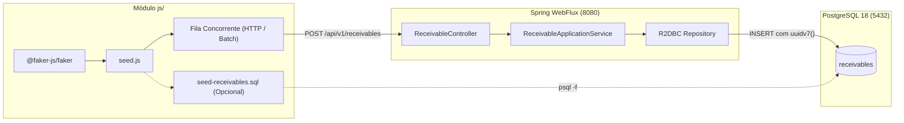

# Plano de Implementação: Seed de Testes com Dados Mockados em JavaScript (`js/`)

Este documento planeja a criação de um módulo de **Seed de Dados** na pasta `js/` do projeto `mydbtest`, utilizando bibliotecas modernas do ecossistema Node.js (`@faker-js/faker`) para gerar dados sintéticos e realistas de recebíveis financeiros, permitindo testar a API WebFlux e a paginação Keyset no PostgreSQL 18 e Swagger UI.

---

## 1. Descrição do Objetivo

O projeto reativo `mydbtest` conta com endpoints para cadastro e consulta de recebíveis (`POST /api/v1/receivables` e `GET /api/v1/receivables?merchantId=...&limit=...&cursor=...`).

Para validar a performance da aplicação reativa, testar a paginação por cursor (keyset pagination) e experimentar o Swagger UI com múltiplos registros reais, precisamos de um mecanismo flexível de geração em massa de dados mockados (*seed*).

O módulo será implementado em uma pasta `js/` utilizando:
- **Node.js 24+** com **ECMAScript Modules (`type: "module"`)** nativo;
- **`@faker-js/faker`** como biblioteca padrão da indústria para dados sintéticos/mockados;
- **Native `fetch`** para disparo concorrente de requisições HTTP contra o Spring Boot reativo;
- **Modo SQL opcional** para carga direta/instantânea de grandes volumes (ex: 50.000 registros) em arquivo `.sql` compatível com o PostgreSQL 18 (`uuidv7()`).



---

## 2. Itens que Requerem Revisão do Usuário

> [!IMPORTANT]
> **Pool Controlado de Lojistas (*Merchants*) para Teste de Paginação:**
> Se cada recebível gerado possuísse um `merchantId` 100% aleatório, a paginação keyset por lojista (`GET /api/v1/receivables?merchantId=...`) sempre retornaria apenas 1 item.
> Por padrão, o script gerará um pool configurável (ex: 5 a 10 lojistas fixos, configurável via flag `--merchants=N`), distribuindo os recebíveis entre eles. Dessa forma, você poderá testar paginação real com dezenas ou centenas de itens por lojista no Swagger UI.

> [!TIP]
> **Dois Modos de Execução:**
> 1. **Modo HTTP (`--mode=http`, padrão):** Envia requisições para a API Spring Boot em execução (`POST /api/v1/receivables`), testando validações de DTO, regras de domínio (taxas, datas de liquidação), conversão reativa e inserção via R2DBC.
> 2. **Modo SQL (`--mode=sql`):** Gera um arquivo SQL pronto (`seed-receivables.sql`) com comandos `INSERT INTO receivables` para carga ultra rápida de grandes massas de teste.

---

## 3. Perguntas Abertas

1. **Volume padrão de Seed:** O valor padrão de 100 registros via HTTP e 5 lojistas atende ao seu fluxo diário de testes, ou prefere outro volume pré-configurado?
2. **Formato do Identificador do Lojista:** Prefere formato UUID (ex: `c8d1729b-8616-48c0-bc6f-7634f56f10c8`) ou códigos de negócio identificáveis (ex: `merch-1001`, `merch-padaria-central`)? *Recomendamos prefixos legíveis ou UUIDs pré-definidos.*

---

## 4. Mudanças Propostas

### 4.1. Configuração do Repositório

#### [MODIFY] `.gitignore`
Adicionar diretórios do Node.js para evitar versionamento de pacotes externos no Git:
```gitignore
# Node.js
node_modules/
js/node_modules/
npm-debug.log*
*.sql
!src/main/resources/db/migration/*.sql
```

---

### 4.2. Módulo JavaScript (`js/`)

#### [NEW] `js/package.json`
Definição do pacote Node.js, dependência do Faker e scripts utilitários:
```json
{
  "name": "mydbtest-seed",
  "version": "1.0.0",
  "description": "Script de seed com dados mockados para o projeto reativo mydbtest",
  "type": "module",
  "main": "seed.js",
  "scripts": {
    "seed": "node seed.js",
    "seed:quick": "node seed.js --count=50 --concurrency=5",
    "seed:bulk": "node seed.js --count=500 --concurrency=20",
    "seed:sql": "node seed.js --mode=sql --count=1000 --output=seed-receivables.sql"
  },
  "dependencies": {
    "@faker-js/faker": "^9.5.0"
  }
}
```

---

#### [NEW] `js/seed.js`
Script principal de geração de dados e disparo:
- **Geração de Dados com `@faker-js/faker`:**
  - `merchantId`: Selecionado a partir de um pool fixo de lojistas (ex: `["merch-loja-01", "merch-loja-02", ...]`).
  - `cardBrand`: Sorteado entre `["VISA", "MASTERCARD", "ELO", "AMEX", "HIPERCARD"]`.
  - `grossAmount`: Valores decimais realistas entre R$ 10,00 e R$ 2.500,00 com duas casas decimais.
  - `feeRate`: Taxas MDR realistas entre 1.5% e 4.5% (`0.0150` a `0.0450`).
  - `installments`: Entre 1 e 12 parcelas.
  - `installmentNumber`: Número válido coerente com o total de parcelas.
  - `transactionDate`: Momentos distribuídos nos últimos 60 dias (`faker.date.recent`).
- **Controle de Concorrência:**
  - Envio em lotes com paralelismo controlado (`--concurrency=10`) para não sobrecarregar as portas TCP sem necessidade e demonstrar a robustez do Spring WebFlux.
- **Relatório no Terminal:**
  - Exibe tempo total decorrido, taxa de sucesso, total de registros inseridos e links diretos para testar no Swagger UI com os lojistas gerados.

---

#### [NEW] `js/README.md`
Instruções rápidas de instalação e uso:
- Pré-requisitos (Node.js 20+ ou 24+);
- Instalação das dependências (`cd js && npm install`);
- Exemplos de comandos e flags (`--count`, `--concurrency`, `--merchants`, `--api-url`, `--mode`);
- Guia de visualização no Swagger UI.

---

## 5. Plano de Verificação

### 5.1. Validação de Sintaxe e Instalação
1. Entrar na pasta `js/` e executar `npm install`.
2. Validar sintaxe com `node --check seed.js`.
3. Executar o modo SQL sem precisar da API ativa:
   ```powershell
   node seed.js --mode=sql --count=20 --output=test.sql
   ```
   Confirmar que o arquivo `test.sql` contém 20 linhas de `INSERT` com sintaxe válida do PostgreSQL.

### 5.2. Validação Integrada com a API Spring Boot
1. Iniciar a aplicação Spring Boot:
   ```powershell
   .\gradlew.bat bootRun
   ```
2. Em outro terminal, executar o seed HTTP:
   ```powershell
   cd js
   node seed.js --count=50 --concurrency=10
   ```
3. Observar as respostas `201 Created` retornadas pelo endpoint reativo.
4. Acessar o Swagger UI em `http://localhost:8080/swagger-ui.html` e executar `GET /api/v1/receivables` passando um dos `merchantId` informados pelo relatório do script.
5. Validar que os registros aparecem ordenados pelo UUIDv7 e que o cursor de paginação avança corretamente.

